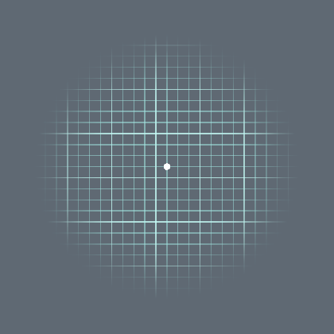

# Внедрение локальной сетки привязки

В Scene View видимая часть сетки образует круг вокруг точки выбора. В центре линии сохраняют обычную яркость, затем плавно исчезают к краю. При построении белая точка совпадает с началом будущего браша. При выборе грани для закрепления она показывает место попадания курсора в грань.



В ветке переноса сетку ведёт `BrushSurfaceGrid`. Откройте меню «Привязки» в панели CSG Brush. При построении отмеченная грань задаёт локальный базис. После создания браш хранит ссылку на опору и базис, чтобы перемещение или дублирование по сетке использовало те же оси. Переключение на мировую сетку освобождает закрепление.

Откройте **CSG Brush → Создать** и выберите форму. Та же кнопка **Создать** доступна на панели CSG Brush окна сцены. Для браша наведите курсор на пол, стену или скат. Бирюзовые линии поворачиваются по нормали поверхности. При первом использовании включён режим локальной сетки. В свободном пространстве линии ложатся на рабочую плоскость Scene View. Белая точка показывает начало будущей формы. Первый щелчок фиксирует плоскость до окончания жеста. Esc отменяет построение.

Шаг привязки задаётся в метрах. При отдалении камеры видны более крупные кратные деления, каждая четвёртая видимая линия выделяется. Отключение привязки позволяет рисовать свободно поверх сетки. В меню **Привязки** можно выбрать мировые оси или закрепить грань и строить по её продолжению. При перемещении браша с сохранённой локальной опорой сетка появляется во время перетаскивания.

[Архивный снимок сетки на вертикальной плоскости](../Вложения/Локальная-сетка-привязки.png).

После свободного перемещения включение магнита сохраняет положение браша. Следующий перенос привязывает изменённые координаты к ближайшим узлам от начала выбранной сетки. Например, при шаге 0,125 м перемещение только по X позволяет поставить опору WCS в X = −0,125 м, 0 м или +0,125 м. Y и Z сохраняются.

В режиме **По форме** каждая ось привязывается по границе габарита, которая проходит через начало WCS. Если обе границы по этой оси отстоят от WCS, используется минимальная координата формы. Это позволяет вернуть угол построения на мировой ноль даже при точных размерах, некратных шагу. Для закреплённой сетки начало и оси задаёт опорная поверхность. Unity хранит Transform в числах одинарной точности. У объекта под повёрнутым или масштабированным родителем мировая координата зависит также от пересчёта локального Transform.

Подписи в метрах на снимке показывают размеры объёма. Их отрисовку и точный ввод описывает [внедрение кликабельных размеров](Размеры-и-редактирование-в-сцене.md).

## Выбор грани и расчёт сетки

1. В Scene View получите луч из позиции мыши через `HandleUtility.GUIPointToWorldRay`. От поиска поверхности нужны `Transform` владельца, мировая точка попадания и мировая нормаль. В простом проекте эти данные даёт `Physics.Raycast` по слоям редактируемой геометрии с `QueryTriggerInteraction.Ignore`. Для CSG или собственного меш-редактора подключите его выбор авторской грани. В исходном пакете `BrushHooks.PickConstructionSurface` проверяет луч по полигонам браша.
2. Возьмите постоянную исходную точку владельца и спроецируйте её на грань. В примере это `owner.position`. Ось X получите из проекции `owner.right` и при почти параллельной нормали возьмите `owner.forward`. Из нормали и оси X соберите ортонормальный базис. Локальная Y смотрит вдоль нормали, X и Z лежат в плоскости. Для стены планировщика используйте точку начала стены и направление вдоль неё, как `GreyboxConstruction.SurfaceGrid`.
3. Между движениями курсора сохраняйте начало координат. Для привязки пересеките плоскость лучом, переведите точку в её базис, округлите X и Z по шагу, задайте Y равной нулю и верните результат в мировые координаты. Для рисования и округления используйте один шаг в метрах. При выключенной привязке передайте ноль в `TrySnap`. В `Draw` по-прежнему можно передавать положительный шаг сетки для справочного отображения.
4. В пакете радиус видимой области равен 12 отображаемым шагам. При видимом шаге 0,125 м радиус равен 1,5 м. Круг перемещается за точкой, а линии сохраняют положение в базисе грани. Яркость начинает плавно убывать с 45% радиуса. Пересечение круга с каждой линией задаёт её концы. Тест глубины `LessEqual` и смещение на 0,001 м вдоль нормали сохраняют перекрытие геометрией сцены.

## Архивный пример для Unity Editor

Архивный пример ниже показывает исходный квадратный предпросмотр и расчёт координат привязки. Круговую отрисовку текущего пакета реализует `BrushSurfaceGrid.Draw`.

```csharp
using UnityEditor;
using UnityEngine;
using UnityEngine.Rendering;

internal readonly struct SurfaceSnapGrid
{
    private const int HalfCellCount = 6;
    private const float DrawOffsetMeters = 0.001f;
    private static readonly Color GridColor = new Color(0.38f, 0.88f, 0.83f, 0.4f);

    private readonly Transform owner;
    private readonly Vector3 localOrigin;
    private readonly Quaternion localRotation;

    internal bool IsValid => owner != null;
    private Vector3 Origin => owner.TransformPoint(localOrigin);
    private Quaternion Rotation => owner.rotation * localRotation;

    private SurfaceSnapGrid(Transform owner, Vector3 origin, Quaternion rotation)
    {
        this.owner = owner;
        localOrigin = owner.InverseTransformPoint(origin);
        localRotation = Quaternion.Inverse(owner.rotation) * rotation;
    }

    internal static bool TryCreate(Transform owner, Vector3 hitPoint, Vector3 hitNormal,
        out SurfaceSnapGrid grid)
    {
        grid = default;
        if (owner == null || hitNormal.sqrMagnitude < 0.000001f)
            return false;

        Vector3 normal = hitNormal.normalized;
        Vector3 tangent = Vector3.ProjectOnPlane(owner.right, normal);
        if (tangent.sqrMagnitude < 0.25f)
            tangent = Vector3.ProjectOnPlane(owner.forward, normal);

        Quaternion rotation = Quaternion.LookRotation(Vector3.Cross(tangent.normalized, normal), normal);
        Vector3 origin = owner.position - normal * Vector3.Dot(owner.position - hitPoint, normal);
        grid = new SurfaceSnapGrid(owner, origin, rotation);
        return true;
    }

    internal bool TrySnap(Ray ray, float stepMeters, out Vector3 point)
    {
        point = default;
        if (!IsValid)
            return false;

        Vector3 origin = Origin;
        Quaternion rotation = Rotation;
        var plane = new Plane(rotation * Vector3.up, origin);
        if (!plane.Raycast(ray, out float distance))
            return false;

        Vector3 local = Quaternion.Inverse(rotation) * (ray.GetPoint(distance) - origin);
        if (stepMeters > 0f)
        {
            local.x = Mathf.Round(local.x / stepMeters) * stepMeters;
            local.z = Mathf.Round(local.z / stepMeters) * stepMeters;
        }
        local.y = 0f;
        point = origin + rotation * local;
        return true;
    }

    internal void Draw(Ray ray, float stepMeters)
    {
        if (!IsValid || stepMeters <= 0f || Event.current?.type != EventType.Repaint)
            return;

        Vector3 center = TrySnap(ray, stepMeters, out Vector3 snapped) ? snapped : Origin;
        Quaternion rotation = Rotation;
        Vector3 offset = rotation * Vector3.up * DrawOffsetMeters;
        Matrix4x4 matrix = Matrix4x4.TRS(center + offset, rotation, Vector3.one);
        float halfWidth = HalfCellCount * stepMeters;
        CompareFunction previousDepthTest = Handles.zTest;
        try
        {
            Handles.zTest = CompareFunction.LessEqual;
            using (new Handles.DrawingScope(GridColor, matrix))
            {
                for (int i = -HalfCellCount; i <= HalfCellCount; i++)
                {
                    float coordinate = i * stepMeters;
                    Handles.DrawLine(new Vector3(coordinate, 0f, -halfWidth),
                        new Vector3(coordinate, 0f, halfWidth));
                    Handles.DrawLine(new Vector3(-halfWidth, 0f, coordinate),
                        new Vector3(halfWidth, 0f, coordinate));
                }
            }
        }
        finally
        {
            Handles.zTest = previousDepthTest;
        }
    }

    internal static void DrawAnchor(Vector3 point)
    {
        if (Event.current?.type != EventType.Repaint)
            return;

        using (new Handles.DrawingScope(Color.white, Matrix4x4.identity))
            Handles.DotHandleCap(-1, point, Quaternion.identity,
                HandleUtility.GetHandleSize(point) * 0.04f, EventType.Repaint);
    }
}
```

## Подключение к инструменту

1. В обработчике `SceneView.duringSceneGui` своего активного инструмента обновляйте кандидат на `MouseMove` и перед обработкой `MouseDown`. После обновления вызывайте `SceneView.RepaintAll()`. В `Repaint` нарисуйте сетку и передайте в `DrawAnchor` ту же точку, которую примет щелчок. Если поиск ничего не нашёл, очистите кандидат. При параллельном луче `TrySnap` возвращает `false`. При `Alt` и навигации Scene View оставляйте управление камере.
2. Для команды «Закрепить сетку по выбранной грани» сохраните выбранный `SurfaceSnapGrid` при щелчке. Пока он действителен, используйте его без повторного поиска грани. Для одиночного построения зафиксируйте базис на первом щелчке и применяйте его до конца жеста. `Esc` отменяет текущий жест или выбор, а «Освободить рабочую сетку» снимает закрепление. При удалении опоры вернитесь к поиску грани под курсором. При деактивации инструмента снимите обработчик Scene View.
3. Пример хранит начало и поворот относительно `Transform`, поэтому закрепление следует за поворотом и перемещением опоры, а размер клетки остаётся в метрах. Если меняется форма целевой грани или неравномерный масштаб, перестройте базис по обновлённой поверхности. Для сохранения связи между открытиями сцены храните ссылку на опору, локальное начало и локальный поворот в авторских данных объекта. Записывайте изменения объекта при подтверждении через `Undo.RecordObject` или регистрируйте создание через `Undo.RegisterCreatedObjectUndo`.
4. При перемещении сборки определите точку привязки, например pivot или выбранный угол. Для сдвига вдоль поверхности сохраните исходную координату по нормали, округлите X и Z точки и примените разность к её объекту. Если нужен шаг по всем трём осям, округлите также Y, как при объёмном перемещении в `BrushSnap`. При включённом магните к вершинам или рёбрам возвращайте его результат до округления по клеткам и показывайте маркер именно в этой точке.

## Проверка после внедрения

Пример отдельно скомпилирован с библиотеками Unity 6000.6.8f1. Интерактивные сценарии ниже выполняются в принимающем проекте после подключения инструмента.

- Наведите курсор по очереди на пол, вертикальную грань и наклонную грань. Сетка ложится в плоскость, маркер прыгает между узлами. При шаге 0,125 м точка с локальными X = 0,19 м и Z = 0,31 м округляется до X = 0,25 м и Z = 0,25 м.
- Закрепите сетку на повёрнутой стене. Уведите курсор за край и начните построение. Базис остаётся привязан к стене. Сместите и поверните опору, затем освободите сетку и наведите курсор на другую грань.
- Поставьте перед сеткой непрозрачный объект и поверните камеру. Объект закрывает линии, на самой грани линии не мерцают. Проверьте совпадение маркера с принятой точкой при включённой и выключенной привязке.
- Начните жест и отмените его `Esc`. Повторите и подтвердите построение. Проверьте Undo/Redo, а для сохраняемой опоры также повторное открытие сцены.
