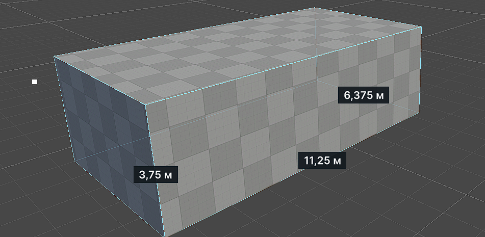

# Внедрение кликабельных размеров в Scene View

За метки браша отвечает `BrushDimensionFields`, за размеры стены и комнаты — `BrushPlanDimensionFields`. Для плана включите «Правка плана стен» и выберите одну стену или комнату. Плиты пола входят в геометрию плана, общая толщина плиты редактируется в Inspector плана.

Включите «Размеры» и выделите объект. Тёмные плашки показывают длину в метрах и локальную ось, например `19,75 м (X)`. На браше X соответствует ширине, Y высоте, Z глубине. У стены X идёт вдоль стены, Y вверх, Z поперёк. Между плашкой и измеряемым ребром остаётся зазор в шесть экранных пунктов Unity. Плашки сохраняют этот зазор при приближении камеры. При перетаскивании грани изменяется число на самой плашке.

На плашке цветом выделена только буква оси. X — красная, Y — зелёная, Z — синяя. Число, «м» и скобки белые. У редактируемой плашки при наведении появляются бирюзовая полоска и текстовый курсор. Левый щелчок открывает поле на её месте. Введите число с точкой или запятой. Обозначение метра и цветная буква оси остаются справа от поля. Ввод меняет контур предпросмотра. Enter применяет размер, Esc или щелчок вне поля отменяет черновик.



## Перетаскивание грани с Ctrl

Включите **Правка формы** на панели CSG Brush или нажмите **B**. Выберите шаг сетки и тяните подсвеченную грань с зажатым **Ctrl**. Расстояние от начала жеста округляется до ближайшего кратного шага. При шаге 0,125 м и исходной ширине 1,03 м первые два шага наружу дают 1,155 и 1,28 м. Обратное движение уменьшает размер такими же ступенями. На блоке противоположная грань сохраняет положение. **Ctrl+Shift** перемещает обе стороны симметрично.

Ctrl действует и при отключённой постоянной привязке. Ограничения формы сохраняются: например, лестница с фиксированной высотой ступени меняется целым числом ступеней. Отпускание кнопки мыши завершает жест, **Esc** отменяет его, **Undo** возвращает предыдущую форму.

## Единицы проекта

Одна мировая единица Unity равна 1 м. Сцена, Inspector и панель CSG Brush используют метры для габаритов, шагов сетки, параметров фигур и выдавливания. Абсолютная точка опоры задаётся в метрах от угла браша, относительная — в долях габарита.

В настройках проекта CSG Brush шаги сетки задаются в метрах через пробел. В дробях принимаются запятая и точка. При первом чтении старых настроек `BrushSettings` делит сохранённые длины на прежний коэффициент единиц на метр и сохраняет результат. При коэффициенте 32 шаг 16 становится 0,5 м, коробка со стороной 64 становится коробкой со стороной 2 м. Индекс шага, нули для значений по умолчанию, углы и допуск кривых сохраняются. Сцены и префабы уже хранят длины в метрах.

## Измерение и выбор подписи

1. Возьмите локальные границы авторской формы и матрицу её преобразования в мир. Для каждой оси измерьте длину преобразованного вектора ребра. Формула `localToWorld.MultiplyVector(axis * localSize).magnitude` учитывает масштаб объекта и родителя. Поворот сам по себе сохраняет размер. Мировую позицию плашки получите из середины ребра через `MultiplyPoint3x4`.
2. Спроецируйте середину и направление ребра, а также центр фигуры через `HandleUtility.WorldToGUIPointWithDepth`. За пределами ближней или дальней плоскости камеры пропустите метку. Рисуйте плашку через `Handles.BeginGUI`. Разместите её снаружи от ребра перпендикулярно его проекции. При наложении плашек сдвиньте следующую дальше в том же направлении. Используйте одно размещение для отрисовки и обработки курсора.
3. Для интерактивной метки передайте устойчивый ключ объекта и свойства, например `id/X`. В `Layout` регистрируйте управление под курсором с приоритетом перед выбором объекта. На левом щелчке внутри рассчитанного прямоугольника откройте поле и поглотите событие. Черновик принадлежит конкретной метке и окну Scene View. При смене выделения или инструмента, Undo/Redo и переходе в Play Mode сбрасывайте состояние редактирования.
4. В CSG Brush+ общий габарит группы, размеры при рисовании и габариты обычного объекта с мешем показываются для чтения. Размер редактируется у одного выбранного браша в объектном режиме с обычными инструментами трансформации вне построения и правки элементов. Генерируемые браши и лестницы, габарит которых вычисляется из параметров, получают метки для чтения. Толщина дверного или оконного проёма управляется опорой. У выбранных стен и комнат редактирование ведёт их отдельный инструмент через те же поля.

## Подключение к данным проекта

Универсальному полю передавайте мировую точку метки, текущее число в метрах, обработчик предпросмотра и обработчик подтверждения. Выбор объекта, допустимые размеры и обновление геометрии ведёт инструмент, который вызывает поле.

| Система | Что передать при внедрении | Как подключено в CSG Brush+ |
| --- | --- | --- |
| Выбор и инструменты | Отфильтровать выделение, скрытые объекты, контекст сцены и активный режим. Для измерения без правки оставить обработчик подтверждения пустым. | `BrushHooks.OnSceneGUI` включает размеры по настройке. `BrushShapeDrawing.DrawSelectionDimensions` выбирает данные и режим подписи. |
| Авторская геометрия и опора | Одним расчётом получить кандидат для контура и для применения. Отношение нового размера к измеренному мировому габариту даёт коэффициент изменения по локальной оси. После изменения вычислить сдвиг, который вернёт неподвижный край на прежнее место. | `GreyboxDimensions.ResizeCandidate` сохраняет край с минимальной координатой. Толщина плиты растёт от верха вниз. Ширина проёма меняется относительно центра. Для произвольного браша трансформируются вершины и внутренняя полость. При компенсации положения сохраняются мировые позиции обычных дочерних объектов. |
| Мировая и локальная привязки | Пометить подтверждённый размер как точный. Следующее обновление сетки должно оставить это значение и принятую позу. Привязку жестов обрабатывает свой инструмент. | `GreyboxDimensions.Resize` сохраняет введённый размер в параметре формы и записывает его в `exactSizeMeters` в локальных единицах параметра. `BrushSnap.SnapBrushSize` сохраняет совпадающее точное значение оси. `BrushSnap.AcceptExactPose` принимает новую позу. При шаге 0,5 м введённые 4,2 м остаются 4,2 м. |
| Undo, префабы, меш и коллайдер | Записать Undo авторских данных и изменяемых трансформов до изменения. Сохранить изменения экземпляра префаба. Пометить производную геометрию для пересборки после применения и Undo/Redo. | `Resize` записывает браш и нужные трансформы через `Undo.RecordObject`, затем сохраняет prefab overrides. `BrushSync.Ensure` сбрасывает кэш и помечает модель для пересборки CSG и коллайдеров. |
| Планировщик помещений | Подключить разрешённые числовые параметры к авторской комнате или сегменту стены. Предпросмотр учитывает связанную геометрию. | `GreyboxPlanTools` передаёт высоту комнаты, высоту и толщину стены, длину стены или хорды. При правке длины перемещается общий конечный узел. Высота общей стены ограничена высотой помещений. Обновление плана помечает генератор на пересборку. |

Геометрию контура и итоговое изменение рассчитывайте в адаптере целевого проекта. После подтверждения перечитайте границы объекта, чтобы плашка отобразила фактический результат. Если адаптер отклонил число по ограничениям формы, покажите причину рядом с объектом.

[Локальная сетка привязки](Локальная-сетка-привязки.md).

## Пример поля для Unity Editor

Ниже сохранён минимальный пример числового ввода из архивной версии. Актуальное размещение плашки и суффикса оси доступно в `BrushDimensionFields.cs`. Для использования примера скопируйте блок в `Assets/Editor/SceneDimensionField.cs`. Вызовите `BeginPass` один раз в начале каждого `SceneView.duringSceneGui`, затем `Draw` для меток в устойчивом порядке во всех событиях Scene View. В `MouseMove` запросите перерисовку. Подключите `Reset` к смене выбранного объекта, режима и Undo/Redo. Для каждого редактируемого свойства передайте `apply` и `preview` своего инструмента. Вызывайте обработчик до выбора объектов по клику.

```csharp
using System;
using System.Collections.Generic;
using System.Globalization;
using UnityEditor;
using UnityEngine;

internal sealed class SceneDimensionField
{
    private static readonly CultureInfo Russian = CultureInfo.GetCultureInfo("ru-RU");
    private static readonly Color Plate = new Color(0.08f, 0.10f, 0.12f, 0.94f);
    private static readonly Color Accent = new Color(0.33f, 0.92f, 0.95f);

    private readonly List<Rect> placed = new List<Rect>();
    private GUIStyle style;
    private SceneView activeView;
    private string activeKey;
    private string draft;
    private bool focusPending;

    internal void BeginPass() => placed.Clear();

    internal void Reset()
    {
        activeView = null;
        activeKey = null;
        draft = null;
        focusPending = false;
    }

    internal static float Measure(Bounds bounds, Matrix4x4 localToWorld, int axis, out Vector3 world)
    {
        Vector3 localAnchor = bounds.min;
        localAnchor[axis] = bounds.center[axis];
        if (axis == 2)
            localAnchor.x = bounds.max.x;
        world = localToWorld.MultiplyPoint3x4(localAnchor);

        Vector3 edge = Vector3.zero;
        edge[axis] = bounds.size[axis];
        return localToWorld.MultiplyVector(edge).magnitude;
    }

    private static bool TryMeters(string text, bool signed, out float meters)
    {
        const NumberStyles number = NumberStyles.AllowLeadingSign | NumberStyles.AllowDecimalPoint;
        return float.TryParse(text?.Trim().Replace(',', '.'), number, CultureInfo.InvariantCulture, out meters)
            && float.IsFinite(meters) && (signed || meters >= 0.001f);
    }

    internal void Draw(SceneView view, string key, Vector3 world, string hint, float meters,
        Action<float> apply = null, Action<float> preview = null, bool signed = false)
    {
        Event current = Event.current;
        if (view == null || view.camera == null || current == null || !float.IsFinite(meters))
            return;

        Vector3 point = HandleUtility.WorldToGUIPointWithDepth(view.camera, world);
        if (point.z < view.camera.nearClipPlane || point.z > view.camera.farClipPlane)
            return;

        if (style == null)
        {
            style = new GUIStyle(EditorStyles.boldLabel) { alignment = TextAnchor.MiddleCenter, fontSize = 14 };
            style.normal.textColor = Color.white;
        }

        bool editable = !string.IsNullOrEmpty(key) && apply != null;
        bool editing = editable && key == activeKey && view == activeView;
        var label = new GUIContent(meters.ToString("0.00###", Russian) + " м", hint);
        float width = editing ? 94f : style.CalcSize(label).x + 12f;
        var rect = new Rect(point.x - width * 0.5f, point.y - 11f, width, 22f);
        for (int i = 0; i < placed.Count; i++)
        {
            if (!rect.Overlaps(placed[i]))
                continue;
            rect.y = placed[i].yMax + 2f;
            i = -1;
        }
        placed.Add(rect);

        bool hover = rect.Contains(current.mousePosition);
        if (editable && hover && !current.alt && current.type == EventType.Layout)
            HandleUtility.AddControl(GUIUtility.GetControlID(FocusType.Passive), -1f);
        if (editing && current.type == EventType.Repaint && TryMeters(draft, signed, out float candidate))
            preview?.Invoke(candidate);

        Handles.BeginGUI();
        try
        {
            if (editing)
            {
                DrawInput(view, key, rect, hover, signed, apply);
                return;
            }
            if (editable)
            {
                EditorGUIUtility.AddCursorRect(rect, MouseCursor.Text);
                if (hover && !current.alt && current.type == EventType.MouseDown && current.button == 0
                    && GUIUtility.hotControl == 0)
                {
                    activeView = view;
                    activeKey = key;
                    draft = meters.ToString("0.#####", Russian);
                    focusPending = true;
                    current.Use();
                    view.Repaint();
                    return;
                }
            }
            if (current.type == EventType.Repaint)
            {
                EditorGUI.DrawRect(rect, Plate);
                if (editable && hover)
                    EditorGUI.DrawRect(new Rect(rect.x, rect.yMax - 2f, rect.width, 2f), Accent);
                GUI.Label(rect, label, style);
            }
        }
        finally
        {
            Handles.EndGUI();
        }
    }

    private void DrawInput(SceneView view, string key, Rect rect, bool hover, bool signed, Action<float> apply)
    {
        Event current = Event.current;
        bool valid = TryMeters(draft, signed, out float value);
        if (current.type == EventType.KeyDown)
        {
            bool enter = current.keyCode == KeyCode.Return || current.keyCode == KeyCode.KeypadEnter;
            if (enter || current.keyCode == KeyCode.Escape)
            {
                current.Use();
                if (enter && !valid)
                    return;
                CloseInput(view);
                if (enter)
                    apply(value);
                return;
            }
        }
        if (current.type == EventType.MouseDown && !hover)
        {
            CloseInput(view);
            return;
        }
        GUI.SetNextControlName(key);
        draft = EditorGUI.TextField(rect, draft);
        if (focusPending)
        {
            EditorGUI.FocusTextInControl(key);
            focusPending = GUI.GetNameOfFocusedControl() != key;
        }
        if (current.type == EventType.Repaint && !valid)
            EditorGUI.DrawRect(new Rect(rect.x, rect.yMax - 2f, rect.width, 2f), Color.red);
    }

    private void CloseInput(SceneView view)
    {
        GUI.FocusControl(null);
        EditorGUIUtility.editingTextField = false;
        Reset();
        view.Repaint();
    }
}
```

Для размеров передавайте ось 0, 1 или 2 в `Measure`. Пропускайте вырожденные габариты. В поле можно вводить число без суффикса «м», с точкой или запятой. Минимальный размер 0,001 м. Для подписанного смещения задайте `signed: true`, тогда отрицательное число задаёт обратное направление, а ноль оставляет объект на месте.

## Проверка после подключения

У выделенного Floor Plan на каждой стене видна тёмная плашка с длиной в мировых метрах. У прямой стены нажмите на число, введите новое значение и нажмите Enter. При вводе виден контур будущего положения, Esc отменяет правку. Зафиксирован конец, ближайший к началу WCS. При равном расстоянии фиксируется начальная точка звена. Соседние стены следуют за перемещённым общим углом. У кривой стены плашка показывает длину вдоль изгиба. В режиме правки отдельной стены доступны также её высота и толщина.

Пример `SceneDimensionField.cs` отдельно скомпилирован с библиотеками Unity 6000.6.8f1. Сценарии ниже выполняются в принимающем проекте после подключения поля к его инструменту.

- Выделите куб в повёрнутом и масштабированном родителе. Сверьте физические размеры. Посмотрите сверху и спереди, где плашки могут пересекаться. Каждая подсвечивает свою область и открывает правильную ось.
- При шаге 0,5 м введите 4,2 м. До Enter меняется только контур. После Enter размер меша и коллайдера равен 4,2 м, выбранный опорный край на прежнем месте. Undo и Redo восстанавливают геометрию и метки.
- Введите 0 для размера и нажмите Enter. Поле остаётся открытым с красной полосой. Проверьте Esc, щелчок вне поля, смену выделения и редактирование при двух открытых Scene View.
- При наличии пола, проёма или планировщика проверьте закреплённый верх плиты, центр проёма и обновление соседней стены при перемещении общего узла. Для префаба проверьте размер после сохранения и повторного открытия сцены.

Протокол приёмки прежнего редактора грейбоксов сохранён в архиве.
