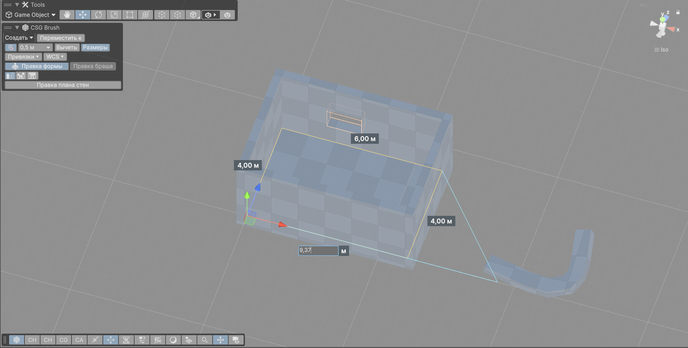

# WCS плана, сплайна и окна, размеры стен

Проверки выполнены на отдельном стенде Unity 6000.6.8f1. Исходная версия — `aa23972` в `main`. Для проверки взаимодействия подготовлена временная сцена с планом 6 × 4 м, окном на высоте 0,95 м и сплайном.

Проверка редактирования опоры сверяет мировые вершины, положение дочернего объекта и полилинию при переносе Transform на верхнюю вершину плана или сплайна. Поворот и неравномерный масштаб родительской системы учитываются. Отдельный случай загружает префаб прежнего формата без полей WCS, сохраняет новую опору на экземпляре и повторно открывает сцену. Геометрия пола и окна на стене сверяется после загрузки.

Для длины прямой стены сравниваются показания в мировых метрах, положение обоих концов, предпросмотр и результат Undo/Redo. При смене направления звена неподвижным остаётся ближайший к WCS конец. Для сглаженной стены проверяется режим чтения. У окна проверяются числовой ввод WCS, перемещение за нижний угол на ту же и другую стену, сохранение уровня подоконника и восстановление привязки при Undo.

Варианты с разным масштабом исходного и принимающего плана, а также с поворотом окна на плане с неравномерным масштабом проверяют мировую ширину и высоту проёма. У более тонкой стены выбранная ранее опора может оказаться за гранью окна. При вводе другой координаты WCS прежнее смещение по глубине сохраняется.

В активном профиле Unity `Default` действия `Tools/Move`, `Tools/Rotate` и `Tools/Scale` назначены на W, E и R без модификаторов. Пакет использует стандартные инструменты или подставляет их контекстные версии для редактирования элементов.

В финальной сборке каталог Unity содержит 482 случая EditMode. Полный применимый прогон прошёл за 59,12 с — 479 из 479, без падений, пропусков и неопределённых результатов. Вне прогона три замера `BrushManagementProbe`, помеченные `Explicit`. Три диагностики масштабирования внутри набора прошли на контрольной сцене из восьми брашей. Каталог PlayMode пуст.

В Play Mode на сцене с планом, окном и сплайном номера кадров продвинулись с 3 136 до 3 627 и затем до 3 868. В сцене действовали 14 частей коллайдеров. Луч через окно прошёл через проём, соседний луч попал в стену. Нижняя кромка окна находилась в 0,95 м над полом. После Stop восстановилось `runInBackground=false`. Новых ошибок в консоли при проверке не было.

## Проверка в графическом редакторе

В Inspector плана, сплайна и окна на стене отображались поля WCS и кнопки выбора и сброса. В Scene View у прямоугольного плана видны четыре тёмные плашки 6,00 и 4,00 м. Щелчок по середине ребра установил WCS плана в (3, 0, 0) м и вернул инструмент Move в режим Pivot с локальными осями.

В объектном режиме и в режиме рёбер в поле длины введено 9,37 м. Esc оставил 6 м, Enter применил 9,37 м, Undo вернул 6 м. Два щелчка «Переместить к» перевели окно со стены 1–2 на стену 3–4. Высота нижней кромки сохранилась на отметке 0,95 м.

При выборе нижнего угла окна его WCS оказалась в (1,35, 0,95, −0,35) м. После двух щелчков по целевой стене этот угол оказался у выбранной отметки 3 м вдоль стены, на высоте 0,95 м.

Щелчок по середине ребра профиля сплайна перенёс WCS с (9, 0, 0) м на (11,951, 1,758, 1,944) м. Редактор вернулся в Move/Pivot/Local. Для трёх выделений через Shortcut Controller вызваны все три действия трансформации. Все девять вызовов переключили активный инструмент. Привязки сверены с профилем редактора. Физическая клавиатура не использовалась. В консоли графического редактора ошибок и предупреждений не было.

[Начало WCS](../Системы/Точка-привязки-браша.md) · [Размещение окна](../Системы/Размещение-по-ребру.md) · [Ввод длины](../Внедрение/Размеры-и-редактирование-в-сцене.md).
