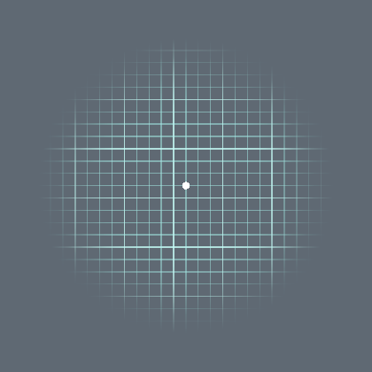

# Круговая сетка и английские названия в Unity

Ветка `codex/english-names-radial-grid` создана от `096925d` ветки `codex/editor-language`. Стенд — отдельная копия Sandbox, Unity 6000.6.8f1. Графические проверки выполнены на D3D11. Код итогового предпросмотра — `684d88d`.

Радиус предпросмотра равен 12 видимым шагам. Белая точка отмечает выбор, а более яркая каждая четвёртая линия остаётся на месте при движении курсора. [Рабочая сетка](../Внедрение/Локальная-сетка-привязки.md) · [Настройки языка CSG Brush](../Системы/Язык-интерфейса.md).

В первом графическом прогоне сверху был виден маркер, а линии на самой грани пропадали. На той же сцене тонкая линия с тестом глубины оставалась видимой, а полоса `Handles.DrawAAPolyLine` при отступе 0,001 м исчезала. Итоговый вариант передаёт цвет и прозрачность вдоль линии через `GL.LINE_STRIP` и сохраняет отступ 0,001 м. Размер центральной точки зависит от расстояния до камеры. Справка Unity 6000.6 — [GL](https://docs.unity3d.com/6000.6/Documentation/ScriptReference/GL.html) и [Handles.DrawSolidDisc](https://docs.unity3d.com/6000.6/Documentation/ScriptReference/Handles.DrawSolidDisc.html).

## Сетка в Scene View

На горизонтальной грани при шаге 0,25 м курсор с координатами X = 0,19 м и Z = 0,31 м дал маркер в точке X = 0,25 м и Z = 0,25 м. В ортографическом виде сверху видны центр, яркие основные деления и плавное исчезновение линий. На скате 30° при шаге 0,5 м проекция круглой области имеет форму эллипса. [Вид сверху](../Вложения/Круговая-сетка-сверху.png) · [Вид на скате](../Вложения/Круговая-сетка-на-скате.png).

Щелчок закрепил сетку на наклонной грани. За краем грани точка оставалась в продолжении плоскости. Esc отменил повторный выбор и сохранил прежнее закрепление. Непрозрачный блок между камерой и плоскостью закрыл проходящие за ним линии. [Проверка перекрытия](../Вложения/Круговая-сетка-перекрытие.png).

## Названия в Unity

Без записи в `EditorPrefs` при запуске активировался English. После выбора русского в ключ записалось `ru`. В обоих режимах Inspector показал заголовок **Brush**. Каталог Add Component содержал `Component/Brush`, а контекстное меню компонента — **To First**, **To Last**, **Move Up** и **Move Down**. В меню **Create / Создать** обнаружены 13 пунктов на выбранном языке. [Brush с русскими полями Inspector](../Вложения/Brush-в-русском-Inspector.png).

В Shortcut Manager сохранились идентификаторы `Brushes/Grid smaller`, `Brushes/Grid larger` и `Brushes/Toggle Shape Handles` с клавишами `[`, `]` и `B` соответственно.

В двух языках сверены 26 регистраций инструментов и три английские подписи горячих клавиш. Команды контекстного меню сверены в каталоге. Нажатие WCS событиями окна в этом прогоне не активировало инструмент. Успешная проверка этой кнопки на родительской ветке описана в [прежнем протоколе](Язык-интерфейса.md).

## Тесты

На итоговой версии `684d88d` в batchmode с D3D11 прошли **457 из 457 применимых EditMode за 56,29 с**, включая три диагностики на временной сцене с `BRUSH_PROBE_SCENE`. Падений, пропусков и неопределённых результатов — 0. В каталоге 460 случаев EditMode, из них три отдельных замера `BrushManagementProbe` помечены `Explicit`. Зарегистрированных PlayMode-тестов — 0.

Оба теста `BrushLanguageTests` прошли. В полном прогоне также прошли `BrushCreationWorkflowTests` (14/14), `BrushDrawTests` (15/15) и `BrushPivotTests` (24/24). В предварительном запуске с `-nographics` восемь тестов окна сцены не прошли без графического устройства, что потребовало полного повтора с D3D11.

В отдельной проверке Play Mode с десятью коллайдерами кадр продвинулся с 3334 через 3544 до 3853. После Stop параметры `PlayerSettings.runInBackground` и `Application.runInBackground` вернулись с true на false. В финальном фоновом запуске ошибок не было. Четыре предупреждения относились к тестовому выпуклому мешу с более чем 256 полигонами, одно — к обработке пути с Unicode в аналитике Pipeline.

Контрольные суммы 78 исходных файлов Sandbox совпали. Исходное отсутствие настройки языка восстановлено. После закрытия тестового Editor Unity CLI вернул `STATUS_NO_INSTANCES`, блокировки обоих проектов сняты.
