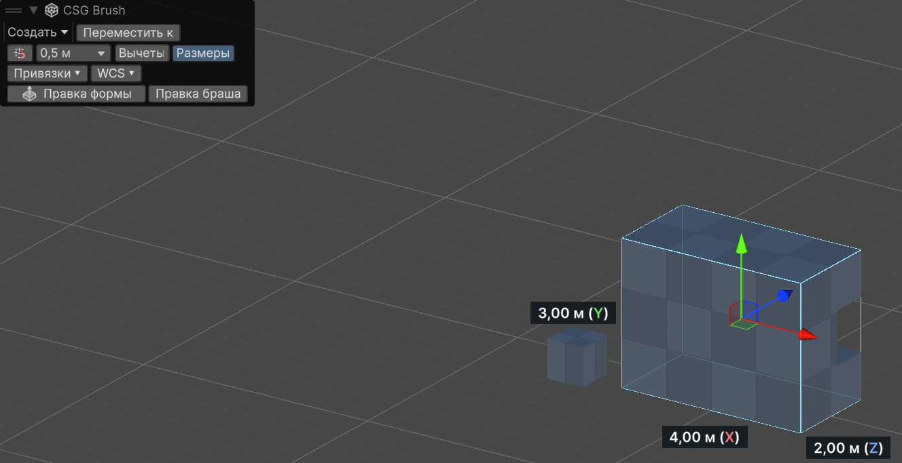

# Панель WCS и цвета осей

Ветка `codex/scene-toolbar-wcs` создана от `b010689` ветки `codex/object-edge-placement`. Версия пакета для проверки — коммит `11082f5`. Стенд — Sandbox, Unity 6000.6.8f1, Unity CLI 1.0.1.

По исходникам [панели](../Системы/Панель-и-инструменты-сцены.md) кнопка «Переместить к» вызывает инструмент размещения. «Вычеты» и «Размеры» используют раздельные переключатели. «Привязки» открывают меню сетки, WCS открывает выбор и сброс начала рабочей системы координат объекта. Меню WCS и Inspector используют общие команды.

В [плашках размеров](../Внедрение/Размеры-и-редактирование-в-сцене.md) один и тот же суффикс используется при чтении и вводе. Тег цвета охватывает только букву оси. Красный X — `#FF7373`, зелёный Y — `#79DD75`, синий Z — `#78AAFF`.

## Регрессия

В каталоге Test Framework 458 случаев EditMode и 0 отдельно зарегистрированных случаев PlayMode. В полном фоновом прогоне прошло 455 из 455 применимых тестов за 58,16 с. Падений, пропусков и неопределённых результатов — 0. Выполнены три сценовые диагностики. Три самостоятельных замера производительности `BrushManagementProbe` с атрибутом `Explicit` исключены из прогона.

Отдельно прошли 74 целевых случая. В `BrushDimensionLabelTests` проверено 7 случаев, в `BrushPivotTests` — 24, в `ObjectEdgePlacementTests` — 22, в `BrushGridSnapTests` — 7 и в `BrushSnapTests` — 14.

В Play Mode на временной сцене с тремя брашами и пятью коллайдерами номер кадра продвинулся с 177 до 207. До входа `runInBackground` был выключен, во время проверки включён, после Stop восстановлен. Компиляция и фоновый прогон завершились без ошибок консоли.

## Проверка в окне сцены

На снимке плавающей панели шириной 250 экранных пунктов видны все подписи. Магнит расположен слева от шага сетки, затем идут «Вычеты» и «Размеры». В следующей строке видны «Привязки» и WCS. На браше габаритом 4 × 3 × 2 м все три буквы окрашены по своим осям. Цифры, единицы и скобки остаются белыми.

Щелчки по «Размеры», «Вычеты» и магниту переключили соответствующие настройки. Кнопка «Переместить к» включила `ObjectPlacementTool`, Esc вернул штатный Move. Щелчок по плашке X открыл числовое поле, после Esc размер остался 4 × 3 × 2 м.

## Inspector

В Inspector видны поля «Режим WCS» и «Начало WCS». Нажатие «Привязать WCS к вершине» включило `BrushPivotTool`. После щелчка по вершине начало переместилось из (0; 1,5; 0) м в (2; 3; −1) м. Нажатие «Сбросить WCS» вернуло его в центр. Все восемь мировых вершин сохранили положение с точностью 0,0001 м. Размер браша остался 4 × 3 × 2 м.

При первой попытке захватить окно Inspector на D3D12 редактор аварийно завершился в `GfxDeviceD3D12Base::GrabIntoRenderTexture`. Проверка кликов и захват окна прошли на D3D11. В консоли этого запуска было 0 ошибок и 0 предупреждений.

Проверка доступности команд WCS в Editor вернула true для одного редактируемого браша и false при пустом выделении. Состав выпадающих меню сверен по исходникам. Щелчки по пунктам открытого нативного меню и отдельные варианты докинга не проверялись.

## Завершение проверки

Один предварительный синхронный запуск тестов завис. Его Editor закрыт через `unity close --force`. Фоновые и графические проверки завершены, CLI вернул `STATUS_NO_INSTANCES`, блокировка Sandbox снята. Четыре настройки восстановлены. Контрольные суммы всех 45 исходных файлов совпали, включая пользовательскую сцену и её .meta. Временная сцена, файлы проб и дамп сбоя удалены.
