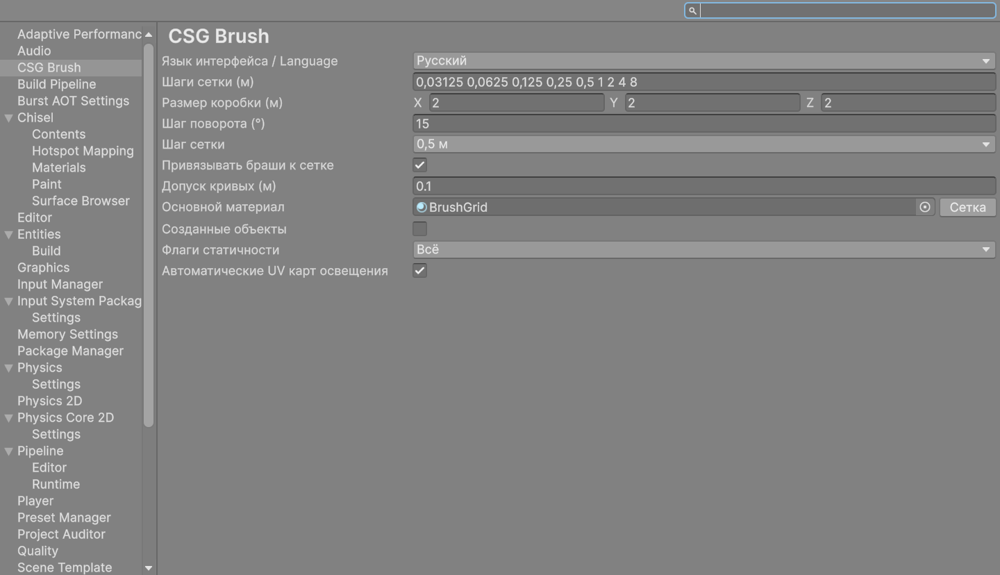
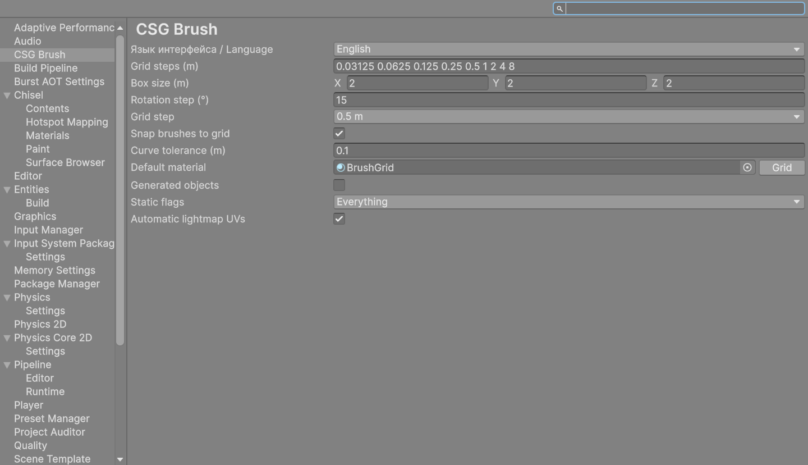

# Проверка русского и английского интерфейса

Стенд — Sandbox, Unity 6000.6.8f1. Перевод добавлен в `codex/editor-language` коммитом `1e31b79`. Путь к переключателю, ключ настройки и ограничения нативных меню указаны в [карточке языка](../Системы/Язык-интерфейса.md).

## Команды создания

На сборке `1e31b79` проверена последовательность Русский → English → Русский. В каждом состоянии все 13 команд появились в исходном порядке на панели и в меню CSG Brush и Tools. После переключения прежние пути нативного меню исчезли. Проверка выполнила 13 нативных команд CSG Brush и программно вызвала 13 обработчиков списка панели в каждом состоянии. Каждая пара включила один и тот же инструмент. Выбор English записал `en` в `EditorPrefs`.

## Причина первоначального падения EditMode

На сборке `1e31b79` прошли 455 из 456 применимых случаев за 56,62 с. На ветке перевода до исправления тест отдельно воспроизвёл единственное падение — `CsgBrush.Tests.FloorPlanTests.ADoorCutsItsPlanWallAndAWindowStandsOnItsSill`. Проверка «the window is open» нашла стену на высоте 1,5 м. В локальных настройках подоконник находился на высоте 6,76 м, выше тестовой стены высотой 3 м.

В отдельной копии `main` (`bd0cfdb`, до добавления перевода) тот же тест зависел от одной настройки.

| Настройки при создании окна | Ширина × высота | Подоконник | Результат |
| --- | --- | --- | --- |
| Стандартные значения пакета | 1,2 × 1,2 м | 0,9 м | Прошёл |
| Копия настроек пользователя | 1 × 1,04 м | 6,76 м | Нашёл стену на высоте 1,5 м |
| Те же настройки, изменена только высота подоконника в памяти | 1 × 1,04 м | 0,9 м | Прошёл |

При первом запуске распаковщик исказил имена отдельных файлов с кириллицей. Перед двумя запусками с пользовательскими параметрами имена восстановили из архива того же коммита. Между этими двумя запусками редактор и файлы проекта оставались теми же.

Теперь при размещении проёмов набор `FloorPlanTests` задаёт стандартные размеры двери и окна и подоконник 0,9 м. Сразу после вызова `WallAnchors.Place` блок `finally` возвращает прежние значения. Геометрия в редакторе по-прежнему использует размеры, выбранные пользователем.

## Проверка после исправления

Исправление тестов проёмов вошло в `43f4708`. После отдельной правки ширины подписей в настройках итоговая сборка `b9a01c9` скомпилировалась на том же стенде. На исходных настройках прошли все 45 случаев `FloorPlanTests` за 2,91 с и проверка `BrushLanguageTests`. Последняя сверяет подписи и порядок всех 13 команд в обоих языках, формат длины, команду сброса WCS и сериализованные настройки проекта.

Каталог Unity содержал 459 случаев EditMode и 0 отдельно зарегистрированных случаев PlayMode. В полном фоновом прогоне `b9a01c9` прошли **456 из 456 применимых случаев за 57,27 с**. Падений, пропусков и неопределённых результатов — 0. В прогон вошли три сценовые диагностики с `BRUSH_PROBE_SCENE`, указывающей на временную сцену с пересекающимися брашами и вычетом. Три замера производительности `BrushManagementProbe` помечены `Explicit` и запускаются отдельно — `MeasureADragFrameInALargeGroup(250)`, `MeasureADragFrameInALargeGroup(1000)`, `MeasureBookkeepingInALargeLevel`.

В Play Mode на итоговой сборке и временной сцене с четырьмя коллайдерами номер кадра продвинулся со 164 до 591. Перед входом `PlayerSettings.runInBackground` и `Application.runInBackground` были выключены, во время прогона включены, после Stop оба вернулись к исходным значениям. В консоли фонового Editor было 0 ошибок и 0 предупреждений.

## Настройки языка в Unity

В графическом Editor на D3D11 при масштабе 150% сначала обрезались двуязычная подпись и длинные русские названия полей. После исправления при ширине окна 960 экранных пунктов обе версии страницы показывают подписи целиком. Вместе с выбором языка меняются единица длины и десятичный разделитель шага сетки.

Щелчок по переключателю открыл нативный список Windows и заблокировал канал автоматизации Unity. Сам выбор проверили штатным событием IMGUI `PopupMenuChanged` на открытой странице настроек. Поле обработало событие и записало `en` в ранее пустой ключ. Нажатие мышью непосредственно на строку в нативном списке не проверялось.

Страница успешно приняла и обратный выбор русского. Затем графический Editor закрыли с выбранным English. В новом процессе Unity прочитала сохранённое `en` и сразу показала все 13 английских пунктов от Box до Spline. После проверки восстановлено исходное отсутствие ключа `EditorPrefs`.

## Inspector и панель сцены

На одном браше размером 4 × 3 × 2 м сопоставлены поля формы, операции, размера, WCS и столкновений. Например, «Начало WCS» сменилось на «WCS origin». Нативный заголовок компонента «Браш» виден в обоих режимах. [Inspector на русском](../Вложения/Инспектор-браша-RU.png) · [Inspector на английском](../Вложения/Инспектор-браша-EN.png).

Щелчок событиями `MouseDown` и `MouseUp` по «Привязать WCS к вершине» и по «Snap WCS to Vertex» в окне Inspector в обоих случаях включил `BrushPivotTool`. Завершение команды вернуло `MoveTool`.

Кнопки «Создать» и «Переместить к» стали «Create» и «Move to». Размеры сцены сохранили цвета осей и численные значения, единицы и десятичный разделитель сменились. На итоговой сборке в каждом языке сверены все 13 пунктов панели и нативного меню. Обработчик `GenericMenu.CatchMenu` и вызов `EditorApplication.ExecuteMenuItem` для каждой соответствующей пары активировали один тип инструмента. [Панель на русском](../Вложения/Панель-сцены-RU.png) · [Панель на английском](../Вложения/Панель-сцены-EN.png).

## Завершение

Консоли итогового графического запуска и запуска после перезапуска пусты. Исходные настройки стенда и раскладка редактора восстановлены. SHA-256 всех 70 файлов, взятых на контроль перед проверкой, совпали, включая пользовательскую сцену и её `.meta`. Временные сцена и копия `main` удалены. Все запущенные для проверки Editor закрыты, Unity CLI вернул `STATUS_NO_INSTANCES`, блокировка Sandbox снята.
