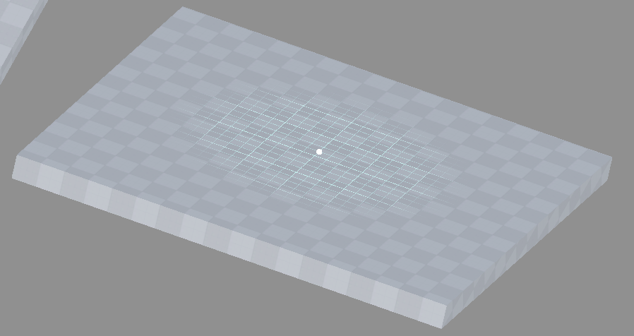
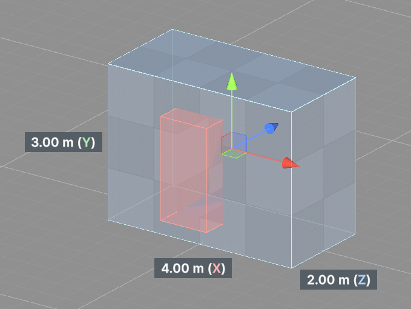
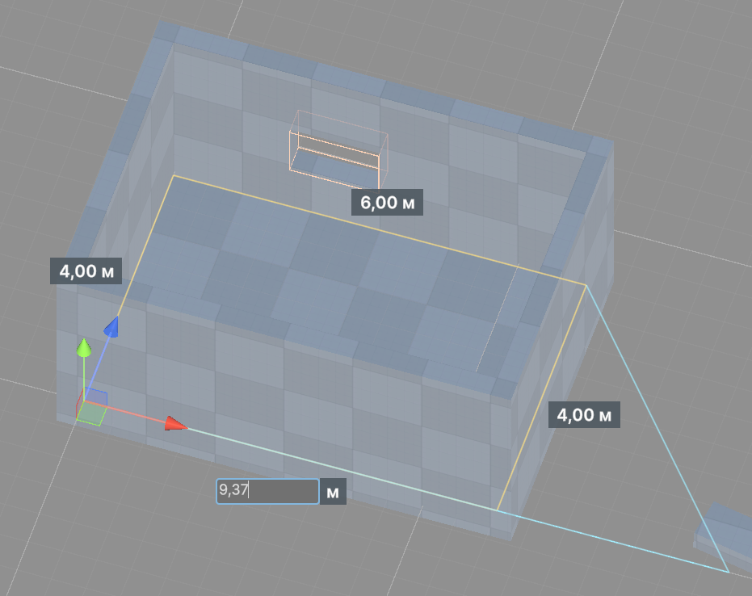
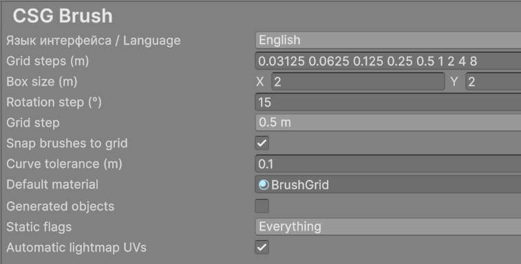

# CSG Brush 0.6.1

This fork builds on [Jaroslav Stehlik's CSG Brush 0.6.0](https://github.com/jaroslavstehlik/csg-brush/tree/71ab1dd51140fa07030dfbe36012047289aa233f). It adds surface-aligned drawing, exact dimensions in the Scene view and geometry-based placement. It also makes large edits with many cuts faster.

## In the Scene view

*Move a 1.25 × 1.6 m cut across the slab. CSG rebuilds the opening at each position.*

<table>
<tr>
<td width="50%"> The drawing grid follows the face and fades around the snap point.</td>
<td width="50%"> Click a brush dimension to enter an exact size.</td>
</tr>
<tr>
<td width="50%"> Type a wall length and preview the change to the shared corner.</td>
<td width="50%"> Switch between English and Russian in Project Settings.</td>
</tr>
</table>

## Features

- **Draw on a surface grid.** Start a brush on a floor, wall or slope. The white dot marks the drawing start and the grid fades around it. Use **Snapping** to choose the world grid or lock the local grid to a face and draw past its edge. Brushes drawn on a local grid can keep snapping along its axes when moved or duplicated.
- **Draw a cut into a face.** Start on a brush or a floor plan wall and draw the depth inward. The orange preview shows the cut on that target. The **+ add** and **- subtract** buttons override the automatic choice. Click the active button again to return to automatic operation.
- **Enter exact dimensions.** Enable **Dimensions** in the Scene overlay to see measurements while drawing or with an object selected. Click an editable brush dimension, type its size in metres and press Enter. The outline previews the change, Esc cancels it, and Undo restores the original size. An entered value can fall between grid steps. In **Shape Edit**, hold Ctrl to resize an eligible handle in grid increments from its starting size, even with the snap magnet off.
- **Set the working coordinate system (WCS).** A drawn brush uses its first point as its origin. For an existing brush, floor plan or spline, choose **WCS > Snap WCS to Vertex** and pick a vertex or edge midpoint. Move and Rotate use that origin. Choosing or resetting it preserves the world pose of the geometry and child objects. A window attached to a floor plan wall can also have its own WCS origin.
- **Move to a vertex or edge.** Select an object and choose **Move to**. Pick a vertex or edge midpoint on another object, then click again at that point or along an adjoining edge. Hold Ctrl for a grid-stepped offset measured from the first point. A window can switch floor plan walls while keeping its sill height above the destination floor.
- **Edit a wall length.** Click the length of a straight floor plan wall and enter a value in metres. The end closest to the plan's WCS stays fixed, and neighbouring walls follow the shared corner. Curved walls show their length along the curve.
- **Choose the editor language.** The CSG Brush overlay, custom Inspectors and settings support English and Russian. Choose **Edit > Project Settings > CSG Brush > Language**. English is the default, and the choice is saved per editor user.

## Changes and fixes

- The Scene overlay groups **Snapping** and **WCS** separately and gives **Move to** and **Dimensions** their own controls. Choosing a creation tool finishes the current edit mode and cancels any unfinished drag or preview.
- Creation respects the Hierarchy's **Default Parent**. The **GameObject > CSG Brush** menu groups brush creation and related commands.
- The grid and size fields use metres. One Unity world unit is one metre. Legacy grid and creation defaults are converted using their stored units-per-metre setting.
- Moving a brush with cuts far from the origin updates its mesh and colliders. Geometry cache keys retain distinct representable positions, and collider clipping runs in coordinates close to the geometry.
- Editing a cut reuses matching convex collider pieces and skips clipping pairs whose bounds are apart. Large meshes with suitable axis-aligned faces use a planar lightmap UV pass. Other meshes use Unity's unwrap. In a test scene with 1,152 cuts, moving one cut took 0.22–0.27 s of combined CSG and UV2 processing, down from 4.78–4.79 s on the preceding build. Both ranges exclude the delay before automatic unwrapping.
- Trigger relay components can be saved with their generated collider pieces and restored when the scene is reopened.

## Development

- Editor scripts can set a brush origin with `BrushApi.SetPivotToVertex(brush, vertexIndex)` or `BrushApi.SetPivotToEdge(brush, a, b)`, and reset it with `BrushApi.ResetPivot(brush)`.
- Store grid and creation defaults directly in metres. The legacy `BrushSettings` preset API has been removed, and `ToMeters` and `ToUnits` now return their input. Pass metre-based grid sizes to `BrushGridMaterial.Generate(int, float[])`. The overload that takes a units-per-metre scale is obsolete.
