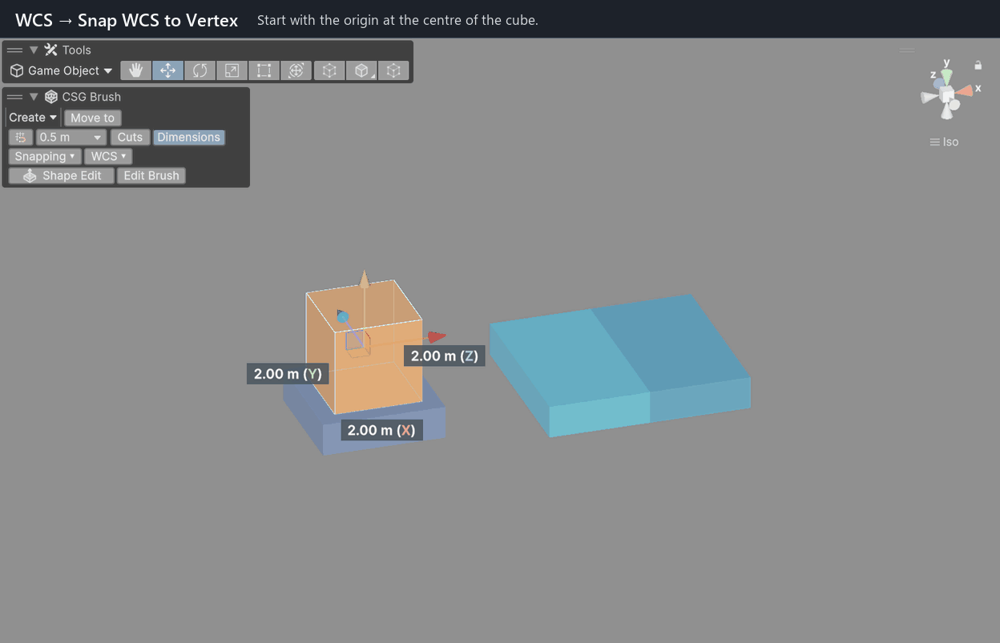
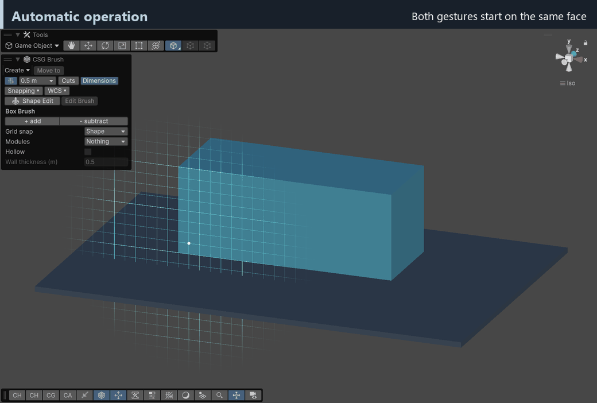
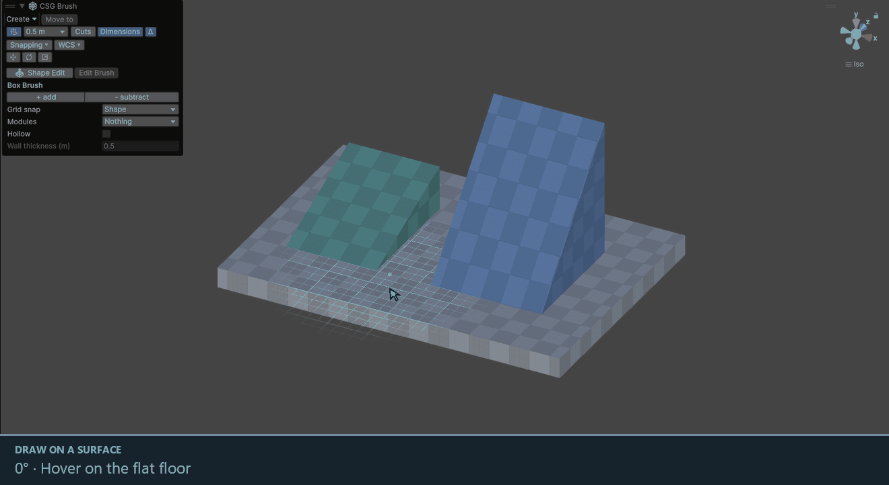
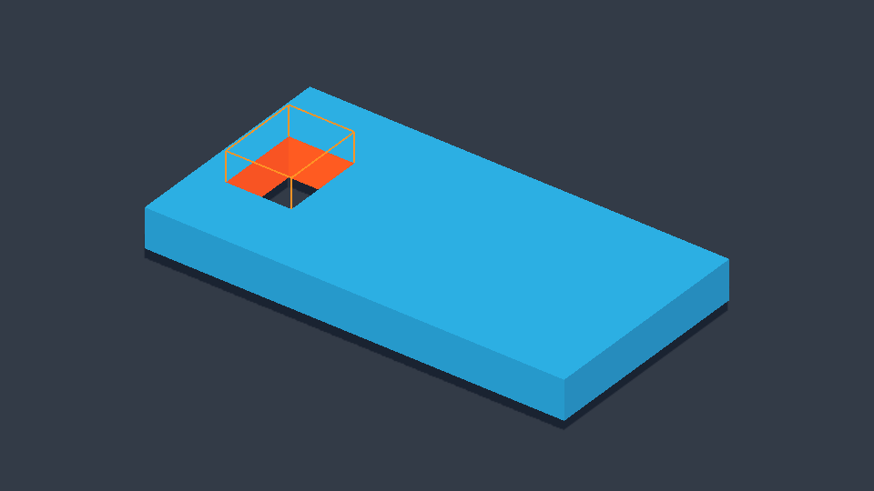

# CSG Brush 0.6.1

CSG Brush lets you block out a level directly in Unity. A *brush* is a shape you can add to the level or use to cut a hole in another shape. Jaroslav Stehlik’s original editor already did both. The changes in this fork are easiest to see while building a small loading bay. How do you land a crate on a raised platform, cut a recess in the wall behind it, and build on a ramp that slopes away from the world grid? [Original CSG Brush 0.6.0](https://github.com/jaroslavstehlik/csg-brush/tree/71ab1dd51140fa07030dfbe36012047289aa233f)

## Land a crate on a platform

*The top face of the blue platform has a seam down its middle. Picking that edge’s midpoint lands the crate’s new pivot exactly at the centre of the platform. Watch the base stay in contact as the height changes.*

Start with a box created from the **GameObject** menu. Its pivot, the point the Move and Rotate tools act on, starts at the centre. To place the bottom edge precisely, open **WCS** (working coordinate system) and choose **Snap WCS to Vertex**. Move the pointer along the bottom edge. Its corners and midpoint light up in turn. Click the midpoint. The gizmo moves there while the crate stays put.

Now click **Move to**. Pick a vertex or an edge midpoint on the platform and click again to land the crate there. For an offset, move along the edge before the second click. The outline shows where the crate will land, and **Ctrl** measures the offset from the picked point in grid steps, even with the magnet off. The crate keeps its rotation and scale. The target can be another brush, an imported mesh, a posed skinned mesh, or a mesh or box collider. Flat triangulated faces expose their perimeter, so a hidden diagonal cannot catch the cursor.

A box drawn in the Scene view already starts with its pivot at the first point you clicked. You can pick a new origin or reset it to the centre later. This also works for floor plans, splines and wall-mounted windows. For a floor plan or spline, the pickable points include graph nodes, link midpoints and edges of the generated shape. **Reset WCS** returns the pivot to the centre of its local bounds. Changing the origin keeps the geometry and child objects in place. Moving the object afterwards carries its children with it.

## Change a size where you see it

Switch on **Dimensions**. The coloured X, Y and Z letters identify which way each measurement runs. Click a number on a selected editable brush and type the size in metres. The outline previews the result as you type. **Enter** applies it and **Esc** cancels. Exact input can fall between grid steps and accepts a decimal point or comma. Groups and ordinary mesh objects show their overall dimensions for reference. When dragging a face in **Shape Edit**, hold **Ctrl** to grow from its current size in steps, or **Ctrl+Shift** to move both sides symmetrically.

The same idea works on a floor plan. Type **9.37 m** on a straight wall and the end nearest the plan’s WCS stays fixed. The other end moves, taking its adjoining walls along. Curved walls show the length of their path. In floor-plan edit mode, a selected wall also exposes height and thickness, and a selected room exposes its height.

<table>
<tr>
<td width="50%"> Each dimension belongs to a local axis.</td>
<td width="50%"> The cyan outline previews the wall edit before Enter.</td>
</tr>
</table>

## Cut into a wall or build out from it

Start a rectangle on a solid brush and give it depth. Push into the face and the orange preview cuts that brush. Pull outwards and the preview switches to an addition. A neighbouring solid can stay intact even if it overlaps the cutter. You can also target one wall of a floor plan. The new cut belongs to its target and follows it when it moves. For manual control, click **+ add** or **− subtract**. Click the active button again to return to automatic selection.

*Both gestures start on the same face. Push in 3 m on the left, then pull out 2.5 m on the right. The tool chooses the operation from the direction.*

## Draw a box on a ramp

Hover over a sloping face. A small grid lies flat against the slope, with a white dot at the snapped point and lines that fade towards the edge of the preview. Draw the base there, then pull out from the slope to give the box height. With **Snapping → Lock grid to a face**, you can keep working on the same plane even beyond the ramp’s edge. Brushes drawn on that grid can also follow its axes when moved or duplicated.

*The three size labels reach 2 m. The base of the finished cube lies flat on the 28° ramp.* [Still image of the surface grid](images/0.6.1/surface-grid.png)

## Keep building in the Scene view

- **Start the next object without leaving edit mode by hand.** Choose a creation tool while editing a brush’s vertices, a floor plan or a spline. The current edit tool closes, any unfinished drag is cancelled, and drawing can begin. Wall segments and spline links you already confirmed stay in the level.
- **Group new objects as you draw.** Choose a GameObject in the Hierarchy and use Unity’s **Set as Default Parent**. New brushes, floor plans and splines are created beneath it. For example, set the loading bay as the parent and the boxes you draw for that bay appear together in the Hierarchy. A targeted cut stays with the brush or plan it cuts.
- **Move a window to another wall.** Pick a corner as the window’s WCS, then use **Move to** on a wall in the same or another floor plan. The opening turns to match the wall, fits its thickness and keeps its sill height above the destination floor.
- **Switch the editor language.** English is the default. Choose Russian in **Edit → Project Settings → CSG Brush** to switch the package’s overlay, settings and custom Inspectors. Unity remembers the choice for that editor user.

## Larger builds and existing projects

Moving brushes far from the world origin now keeps their visible meshes, cut faces and colliders together. When one opening moves in a heavily cut solid, the builder reuses unchanged collider pieces. Large, suitable axis-aligned meshes also get a faster second UV layout for baked lighting. In one Unity scene with **1,152 cuts**, moving a single cut took **0.22–0.27 s** of CSG and lightmap UV processing, down from **4.78–4.79 s** in the preceding Plus build. Both measurements exclude the wait before automatic unwrapping.

*Here the cut already exists. Moving it shifts the opening in both the visible slab and its collider.*

A world unit is one metre throughout the fork. Existing project settings convert their saved lengths on first use. For example, a grid step of 16 at 32 units per metre becomes 0.5 m. Existing scene geometry stays the same physical size. Trigger relays now survive saving and reopening a scene. Rebuilding an older prefab also reconnects its generated trigger collider to the owning brush if 0.6.0 saved the relay with an empty script reference.

Editor scripts can set a brush origin with `BrushApi.SetPivotToVertex`, `BrushApi.SetPivotToEdge` and `BrushApi.ResetPivot`. The former unit-preset API has been removed. Pass lengths in metres to `BrushGridMaterial.Generate(int, float[])`. The legacy `ToMeters` and `ToUnits` methods now return their input.

For contributors, the [development sandbox](https://github.com/veagis1/csg-brush/tree/main/Development~/Sandbox) includes a URP setup, a first-person controller using Unity’s Input System, and a Chisel sample for comparison. These dependencies are scoped to the sandbox.
